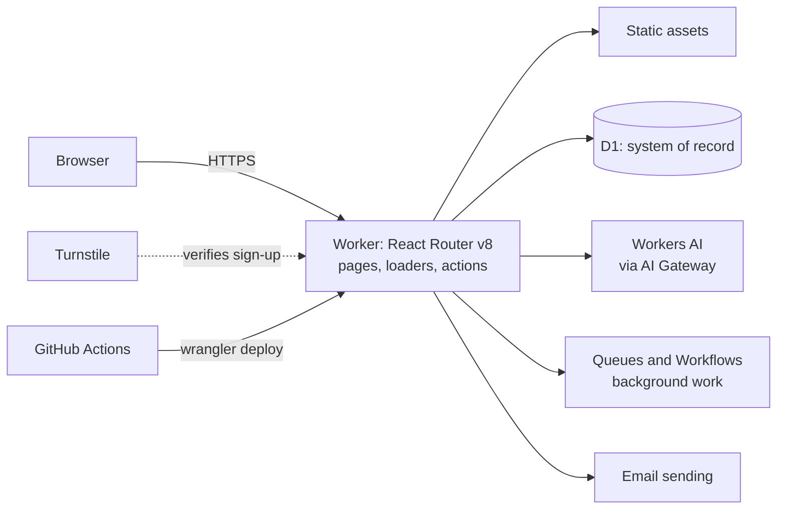

# Architecture

Timesifier runs entirely on Cloudflare. One Worker serves the pages, runs the server code and talks to every other service through bindings.

Status: the scaffold is deployed at `https://timesifier.com` and the pipeline deploys every merge. The parts below arrive with the cards named beside them. Why each part was chosen is in `docs/decisions.md`.

## Shape



## Parts

| Part            | Cloudflare product                               | Used for                                                                   | Arrives with    |
| --------------- | ------------------------------------------------ | -------------------------------------------------------------------------- | --------------- |
| Application     | Workers, React Router v8, Cloudflare Vite plugin | Pages, loaders, actions                                                    | TS-001          |
| Static files    | Workers Static Assets                            | Scripts, styles, images                                                    | TS-001          |
| Database        | D1 (binding `DB`), Drizzle ORM, SQL migrations   | Users, organisations, time entries, everything durable                     | TS-007          |
| Authentication  | Better Auth in the Worker, data in D1            | Email-code sign-in, passkeys, sessions; organisations, roles, invitations  | TS-008, TS-009  |
| Bot protection  | Turnstile, checked by the Worker                 | The request that sends a sign-in code, which is also how an account starts | TS-008          |
| Email           | Cloudflare Email Service (binding `EMAIL`)       | Codes, invitations, later summaries; from `no-reply@mail.timesifier.com`   | TS-008          |
| AI              | Workers AI behind AI Gateway                     | Category suggestions                                                       | TS-015          |
| Background work | Queues, Workflows, Cron Triggers                 | Weekly summaries, batches                                                  | TS-018          |
| Files           | R2                                               | Data exports                                                               | TS-021          |
| Real-time       | Durable Objects                                  | Only when a feature needs live coordination                                | Not planned yet |
| Observability   | Workers Logs and Traces                          | Structured logs, traces, alerts                                            | TS-001, TS-022  |

## Environments

| Environment | Where                                                                     | Data                                                     |
| ----------- | ------------------------------------------------------------------------- | -------------------------------------------------------- |
| Local       | `pnpm dev`, running in the Workers runtime                                | Local D1 file under `.wrangler/`, secrets in `.dev.vars` |
| Preview     | `https://pr-<number>-timesifier.ayoinc.workers.dev`, one per pull request | D1 database `timesifier-preview`, shared by all previews |
| Production  | `https://timesifier.com`                                                  | D1 database `timesifier`                                 |

Both remote databases were created on 2026-11-11 with `wrangler d1 create <name> --jurisdiction eu`. `wrangler.jsonc` binds `DB` to `timesifier` at the top level and to `timesifier-preview` in its `previews` block. The local database is built from the same migrations with `pnpm db:migrate:local`, and tests build their own copy inside the Workers runtime.

Authentication differs by environment in three ways, all set in `wrangler.jsonc`. Production has the `EMAIL` binding, which may send only from `no-reply@mail.timesifier.com`; a preview has no such binding and sends nothing, because its address is public; locally Wrangler simulates the binding, printing the envelope and writing the message under `.wrangler/tmp/email/`. Production uses its own Turnstile widget; previews, local development and tests use Cloudflare's published test keys. `BETTER_AUTH_SECRET` is a different value in each environment.

## Data rules

- Every table that holds customer data has an `organisation_id`. Code reads and writes it only through the organisation-scoped data layer, `organisationScope` in `app/db/`. The scope sets the organisation of every row it writes and adds it to every statement, and it accepts only tables that have the column. An update or delete must name its rows with a filter, or pass `everyRow`. The linter refuses an import of the tables anywhere outside `app/db/` and `app/auth/`.
- Ids are UUID version 7 text, generated in the application. Times are stored in UTC, as integers holding milliseconds since the Unix epoch, and shown in the person's time zone. The reasons are in `docs/decisions.md` entry 17.
- Foreign keys are enforced: D1 checks them on every query and migration, as SQLite does with `PRAGMA foreign_keys = on`. A migration can defer the check to the end of its transaction with `PRAGMA defer_foreign_keys = on`, but cannot switch it off (<https://developers.cloudflare.com/d1/sql-api/foreign-keys/>).
- The schema is `app/db/schema.ts`. A schema change is a SQL migration generated from it by `pnpm db:generate` and committed in `migrations/`; a test fails when the two disagree. Migrations are applied to remote databases by the pipeline only.
- Both remote databases are restricted to the `eu` jurisdiction. Cloudflare's D1 documentation says a jurisdiction creates a database that "only run[s] and store[s] data within a region", and that read replicas are created only inside it. This differs from a location hint such as `--location weur`, which "does not guarantee that D1 runs in your preferred location". A jurisdiction can be set only when the database is created and cannot be changed afterwards. It governs where the database runs and keeps its data, not where the Worker that queries it runs. The binding needs no extra field: it names the database by id. Source: <https://developers.cloudflare.com/d1/configuration/data-location/>, read 2026-11-11.
- Better Auth owns five tables: `sessions`, `accounts`, `verifications`, `passkeys` and `rate_limits`, and it writes `users`. They follow the same rules for names, ids and times, and are created by the same migrations. None has an `organisation_id`: a session or a passkey belongs to a person, not to an organisation, so they are reached through Better Auth and not through `organisationScope`. `verifications` holds a hash of each emailed code and the challenge of a passkey ceremony in progress; `rate_limits` holds one counter per client address and sign-in path. `accounts` is required by Better Auth and stays empty until a sign-in method that uses it is added.
- Better Auth's organization plugin (TS-009) uses `organisations` and `memberships` as its `organization` and `member` models and adds one table, `invitations`: an offer of membership sent to an email address, with the role offered, who sent it, a status and an expiry. `memberships` and `invitations` have an `organisation_id` and are in `organisationScope`. The plugin, inside `app/auth/`, is the one writer that reaches them without the scope; our own reads of them go through it. The plugin also needs a column on `sessions`, `active_organisation_id`, which it writes and nothing reads (`docs/decisions.md` entry 20). Its field `organizationId` is mapped to our `organisationId` in `app/auth/organisations.server.ts`.

## Delivery

One workflow, `.github/workflows/ci.yml`, does all of it.

1. A pull request runs install with a frozen lockfile, typecheck, lint, tests, build, the browser tests, a secret scan and a dependency audit that fails on a moderate or worse advisory.
2. When those pass, the migrations are applied to the preview database, the pull request gets a preview (`wrangler preview --name pr-<number>`), the smoke test runs against it, and its URL is posted as a comment. Closing the pull request deletes the preview.
3. Merging to `main` runs the same checks, then applies the migrations to the production database, then `wrangler deploy`, then the smoke test against production.
4. The smoke test is `scripts/smoke.sh`: the home page must answer 200 and contain the product name. Against production it also requires `www` to redirect to the apex, plain HTTP to redirect to HTTPS, and the workers.dev address of the version just deployed to answer 404 (see `docs/security.md`, "One host in production"). A failure fails the workflow; it does not roll back by itself.
5. Migrations are applied before the new code is live, so each one must work with the code already running: add a column in one release, stop using the old one in the next, remove it in a third. All previews share one database, so a migration on an open pull request reaches the other previews too.

Production is deployed only by the pipeline. The one exception was the first deploy on 2026-11-11, made from the owner's machine, because a token limited to one Worker cannot create that Worker.

### The pipeline's token

An account-owned Cloudflare API token named `timesifier-ci-deploy`, held in the GitHub Actions secret `CLOUDFLARE_API_TOKEN` and passed only to the steps that call Wrangler. It expires on **2027-11-11**; replace it before then in the Cloudflare dashboard under Manage Account, Account API tokens.

| Scope                            | Permission     | Used for                              |
| -------------------------------- | -------------- | ------------------------------------- |
| Worker `timesifier` only         | Editor         | Deploys, previews, rollbacks          |
| Zone `timesifier.com` only       | Workers Routes | The two custom domains                |
| Every D1 database in the account | D1 write       | Applying migrations from the pipeline |

Cloudflare offers no per-database scope for D1, so the last row is wider than this project. Checked on 2026-11-11: the token is refused when it asks for another Worker's settings or for this zone's DNS records.

### Rollback

```sh
pnpm exec wrangler deployments list                      # find the version to return to
pnpm exec wrangler rollback <version-id> -m "<reason>"   # production serves it within seconds
```

A rollback changes the code only. It does not undo a database migration, a secret or a setting. Then revert the faulty commit on `main`, or the next merge deploys it again.

Rehearsed on 2026-11-11: at 02:36:49 UTC production was rolled back from version `05a58e49` to `d1625379` and answered 200; at 02:37:07 UTC it was returned to `05a58e49` with `wrangler versions deploy 05a58e49-27a2-49bf-a36e-4bd17fbeffae@100%` and answered 200.

## The domain

`timesifier.com` is a zone in the owner's Cloudflare account. Before 2026-11-11 it held 27 DNS records and served no website: the apex and `www` had no address records. TS-003 attached both names to the Worker as custom domains. `www` redirects to the apex with status 308.

The zone carries **live email configuration** and one other service that the application must leave alone:

| Name                                                                  | What is there                                                             |
| --------------------------------------------------------------------- | ------------------------------------------------------------------------- |
| `timesifier.com`                                                      | MX to Microsoft 365, SPF, a Microsoft verification record, DMARC `p=none` |
| `autodiscover`                                                        | Outlook autodiscover                                                      |
| `*._domainkey`, `send`, `send.updates`, `plunk`, `resend._domainkey*` | DKIM and bounce records for Amazon SES, Resend, Plunk and iCloud mail     |
| `trade`                                                               | Cloudflare email routing and sending records with DMARC `p=reject`        |
| Two `_…` CNAMEs                                                       | AWS certificate validation                                                |
| `paperclip`                                                           | Another Worker of the owner's, on its own custom domain                   |

The application adds only the Worker custom domains for the apex and `www`, and later one dedicated subdomain for its own outgoing email. TS-003 checked the zone after the first deploy: of its 29 records, the only two created or changed that day were the Worker records for the apex and `www`.

## Versions

Read from the lockfile on 2026-11-11. The lockfile is the source of truth; update this table when a major version changes.

| Tool                     | Version    |
| ------------------------ | ---------- |
| Node                     | 26         |
| pnpm                     | 12.18.0    |
| Wrangler                 | 4.159.0    |
| React Router             | 8.5.1      |
| React                    | 19.3.1     |
| Cloudflare Vite plugin   | 1.68.0     |
| Vite                     | 8.3.7      |
| Tailwind CSS             | 4.3.5      |
| Vitest                   | 4.1.12     |
| Cloudflare Vitest plugin | 1.6.1      |
| Biome                    | 2.6.6      |
| TypeScript               | 5.9.3      |
| Zod                      | 4.6.7      |
| Drizzle ORM              | 0.45.4     |
| Drizzle Kit              | 0.31.11    |
| Material Color Utilities | 0.4.0      |
| Roboto Flex (Fontsource) | 5.3.0      |
| Better Auth              | 1.7.19     |
| React Aria Components    | 1.22.1     |
| Playwright               | 1.65.0     |
| `compatibility_date`     | 2026-11-09 |
