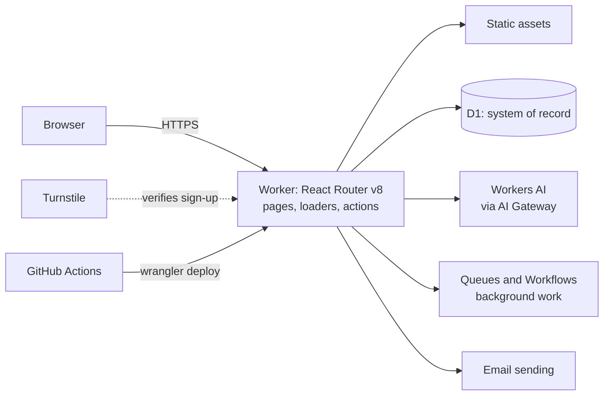

# Architecture

Timesifier runs entirely on Cloudflare. One Worker serves the pages, runs the server code and talks to every other service through bindings.

Status: nothing is built or deployed yet. This is the target the board builds towards. Why each part was chosen is in `docs/decisions.md`.

## Shape

## Parts

| Part            | Cloudflare product                               | Used for                                                | Arrives with    |
| --------------- | ------------------------------------------------ | ------------------------------------------------------- | --------------- |
| Application     | Workers, React Router v8, Cloudflare Vite plugin | Pages, loaders, actions                                 | TS-001          |
| Static files    | Workers Static Assets                            | Scripts, styles, images                                 | TS-001          |
| Database        | D1 with Drizzle and SQL migrations               | Users, organisations, time entries, everything durable  | TS-007          |
| Authentication  | Better Auth in the Worker, data in D1            | Passkeys, email sign-in, sessions, organisations, roles | TS-008          |
| Bot protection  | Turnstile                                        | Sign-up                                                 | TS-008          |
| Email           | Cloudflare email sending, from its own subdomain | Verification and summaries                              | TS-008          |
| AI              | Workers AI behind AI Gateway                     | Category suggestions                                    | TS-015          |
| Background work | Queues, Workflows, Cron Triggers                 | Weekly summaries, batches                               | TS-018          |
| Files           | R2                                               | Data exports                                            | TS-021          |
| Real-time       | Durable Objects                                  | Only when a feature needs live coordination             | Not planned yet |
| Observability   | Workers Logs and Traces                          | Structured logs, traces, alerts                         | TS-001, TS-022  |

## Environments

| Environment | Where                                      | Data                                  |
| ----------- | ------------------------------------------ | ------------------------------------- |
| Local       | `pnpm dev`, running in the Workers runtime | Local D1 file, secrets in `.dev.vars` |
| Preview     | A preview URL per pull request             | Preview D1 database                   |
| Production  | `https://timesifier.com`                   | Production D1 database                |

## Data rules

- Every table that holds customer data has an `organisation_id`. Code reads and writes it only through the organisation-scoped data layer.
- Times are stored in UTC and shown in the person's time zone.
- Schema changes are SQL migrations in the repository, applied to remote databases by the pipeline only.
- The production database is created in the EU. The exact option is confirmed in TS-007.

## Delivery

1. A pull request runs install with a frozen lockfile, typecheck, lint, tests, build, a secret scan and a dependency audit.
2. A passing pull request gets a preview URL.
3. Merging to `main` applies migrations and deploys to production, then runs a smoke test.
4. Rollback: redeploy the previous Worker version with Wrangler. The exact command and a rehearsal are part of TS-003.

## The domain

`timesifier.com` is already a zone in the owner's Cloudflare account. On 2026-11-11 it held 25 DNS records and served no website: the apex and `www` had no address records.

The zone carries **live email configuration** that the application must leave alone:

| Name                                                                  | What is there                                                             |
| --------------------------------------------------------------------- | ------------------------------------------------------------------------- |
| `timesifier.com`                                                      | MX to Microsoft 365, SPF, a Microsoft verification record, DMARC `p=none` |
| `autodiscover`                                                        | Outlook autodiscover                                                      |
| `*._domainkey`, `send`, `send.updates`, `plunk`, `resend._domainkey*` | DKIM and bounce records for Amazon SES, Resend, Plunk and iCloud mail     |
| `trade`                                                               | Cloudflare email routing and sending records with DMARC `p=reject`        |
| Two `_…` CNAMEs                                                       | AWS certificate validation                                                |

The application adds only the Worker custom domains for the apex and `www`, and later one dedicated subdomain for its own outgoing email. TS-003 exports the zone before and after and compares the two.

## Versions

Read from the lockfile on 2026-11-11. The lockfile is the source of truth; update this table when a major version changes.

| Tool                     | Version    |
| ------------------------ | ---------- |
| Node                     | 26         |
| pnpm                     | 12.18.0    |
| Wrangler                 | 4.159.0    |
| React Router             | 8.5.1      |
| React                    | 19.3.1     |
| Cloudflare Vite plugin   | 1.68.0     |
| Vite                     | 8.3.7      |
| Tailwind CSS             | 4.3.5      |
| Vitest                   | 4.1.12     |
| Cloudflare Vitest plugin | 1.6.1      |
| Biome                    | 2.6.6      |
| TypeScript               | 5.9.3      |
| `compatibility_date`     | 2026-11-09 |
