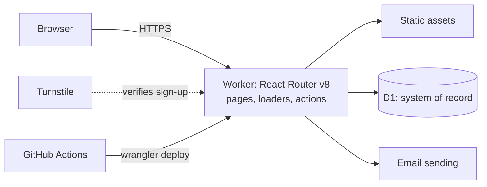

# Architecture

Timesifier runs entirely on Cloudflare. One Worker serves the pages, runs the server code and talks to every other service through bindings.

This page describes what is built. What is planned is marked as planned, with its card. Why each part was chosen is in `docs/decisions.md`.

## Shape



## Parts

| Part           | Cloudflare product                               | Used for                                                                   | Status                                      |
| -------------- | ------------------------------------------------ | -------------------------------------------------------------------------- | ------------------------------------------- |
| Application    | Workers, React Router v8, Cloudflare Vite plugin | Pages, loaders, actions                                                    | Built (TS-001)                              |
| Static files   | Workers Static Assets                            | Scripts, styles, images                                                    | Built (TS-001)                              |
| Database       | D1 (binding `DB`), Drizzle ORM, SQL migrations   | Users, organisations, time entries, everything durable                     | Built (TS-007)                              |
| Authentication | Better Auth in the Worker, data in D1            | Email-code sign-in, sessions; organisations, roles, invitations            | Built (TS-008, TS-009)                      |
| Bot protection | Turnstile, checked by the Worker                 | The request that sends a sign-in code, which is also how an account starts | Built (TS-008)                              |
| Email          | Cloudflare Email Service (binding `EMAIL`)       | Codes and invitations, from `no-reply@mail.timesifier.com`                 | Built (TS-008)                              |
| Observability  | Workers Logs and Traces                          | Logs and traces                                                            | Built (TS-001). Planned: an alert (TS-022a) |

The production Turnstile widget is in Cloudflare's non-interactive mode: it never shows a tick box.

### Not built

Nothing below is bound to the Worker today. Each joins when the feature named needs it.

| Part            | Cloudflare product           | The feature that would need it                                           | Status                   |
| --------------- | ---------------------------- | ------------------------------------------------------------------------ | ------------------------ |
| AI              | Workers AI behind AI Gateway | A suggested project for an entry                                         | Planned (TS-015)         |
| Background work | Cron Trigger                 | The weekly summary; deleting expired rows                                | Planned (TS-018, TS-033) |
| Files           | R2                           | A nightly copy of the database                                           | Planned (TS-022b)        |
| Real-time       | Durable Objects              | A change that must be pushed to a person's other devices within a second | Not planned              |

## Routes

`app/routes.ts` is the route tree. The shell's destinations come from the one list in `app/shell/destinations.ts`.

| Address                        | Module                        | What it is                                                                                                                                                                                                                                         |
| ------------------------------ | ----------------------------- | -------------------------------------------------------------------------------------------------------------------------------------------------------------------------------------------------------------------------------------------------- |
| every page                     | `app/root.tsx`                | The document. Its loader reads the colour-scheme cookie and negotiates the locale; it runs again after a form is submitted, and after a navigation that leaves the path unchanged.                                                                 |
| `/`                            | `routes/home.tsx`             | The home page, with a link to `/app`. Public pages are a later card.                                                                                                                                                                               |
| `/sign-in`                     | `routes/sign-in.tsx`          | Sign in: the email address, then the emailed code. Its loader sends a person who has a session on to `/app`. Its `headers` ask for the Turnstile addition to the policy.                                                                           |
| `/sign-up`                     | `routes/sign-up.tsx`          | Create an account: name and email, then the emailed code, and on to where the person was going. The same loader and `headers` as `/sign-in`.                                                                                                       |
| `/app`                         | `routes/app/layout.tsx`       | The application shell: skip link, navigation, main region. Its `middleware` is the session guard: without a session, every route under it redirects to `/sign-in?next=…`.                                                                          |
| `/app` (index)                 | `routes/app/index.tsx`        | Where a signed-in person goes when no organisation is named: to their one organisation, to `/app/new` when they have none, or a list to choose from when they have several.                                                                        |
| `/app/new`                     | `routes/app/new.tsx`          | Create an organisation: its name, one action. The person becomes its owner and lands on its Today.                                                                                                                                                 |
| `/app/<slug>`                  | `routes/app/organisation.tsx` | The layout of one organisation's pages. It draws nothing; its `middleware` is the membership check, which answers the same 404 for a slug nobody has and for an organisation the person is not in (`docs/security.md`, "Organisations and roles"). |
| `/app/<slug>` (index)          | `routes/app/today.tsx`        | Today. A placeholder.                                                                                                                                                                                                                              |
| `/app/<slug>/reports`          | `routes/app/reports.tsx`      | Reports. A placeholder.                                                                                                                                                                                                                            |
| `/app/<slug>/projects`         | `routes/app/projects.tsx`     | Projects. A placeholder.                                                                                                                                                                                                                           |
| `/app/<slug>/settings`         | `routes/app/settings.tsx`     | Settings. The organisation's: its name, and for an owner its deletion, confirmed by typing the name. The person's own: their name, the colour scheme, signing out. One `action`; each form names what it asks for.                                 |
| `/app/<slug>/settings/members` | `routes/app/members.tsx`      | Members and pending invitations, with the actions the person's role allows and no others.                                                                                                                                                          |
| `/invitations/<id>`            | `routes/invitations.$id.tsx`  | An invitation's own page, outside `/app` because the person it is for is not a member yet. Signed out, it sends the person to sign in and back. A valid invitation offers Join and Decline; every other case is one page with status 410.          |
| `/api/auth/*`                  | `routes/api.auth.$.ts`        | Better Auth.                                                                                                                                                                                                                                       |
| `/design`                      | `routes/design.tsx`           | The component gallery. Registered under `pnpm dev` and in a build made with `DESIGN_ROUTE=1` only.                                                                                                                                                 |

What the two sign-in pages share is in `app/routes/auth/`: the frame and the steps (`AuthPage.tsx`, `SendCodeForm.tsx`, `CodeStep.tsx`), the link from each page to the other (`links.tsx`), the Turnstile widget (`RobotCheck.tsx`), the calls to Better Auth from the browser (`client.ts`), the guard and what the pages load (`session.server.ts`), and the addresses with the rule for `next` (`paths.ts`). The folder also holds `AccountSettings.tsx`, the account part of the Settings page. The guard, the `next` rule and the Turnstile addition are described in `docs/security.md`.

The home page changes, and a privacy page and a terms page join the table, with TS-030's pull request.

How the shell looks, moves and takes the focus is in `docs/design-system.md`, "Shell".

## Environments

| Environment | Where                                                                     | Data                                                     |
| ----------- | ------------------------------------------------------------------------- | -------------------------------------------------------- |
| Local       | `pnpm dev`, running in the Workers runtime                                | Local D1 file under `.wrangler/`, secrets in `.dev.vars` |
| Preview     | `https://pr-<number>-timesifier.ayoinc.workers.dev`, one per pull request | D1 database `timesifier-preview`, shared by all previews |
| Production  | `https://timesifier.com`                                                  | D1 database `timesifier`                                 |

Those two addresses and the two databases are this project's own deployment. None of them is in the code or in `wrangler.jsonc`: the host, the account's workers.dev subdomain, the two database ids, the Turnstile site key and the sender address are repository variables in GitHub, which the pipeline checks and writes into the Wrangler configuration before it builds (`scripts/deploy-config.ts`). The committed `wrangler.jsonc` is a developer's machine's, with database ids that are no database's, so nothing run from a clone reaches a remote one. `docs/security.md`, "Secrets", lists every setting; `README.md`, "Deploying your own", is how another deployment is made.

Both remote databases were created on 2026-11-11 with `wrangler d1 create <name> --jurisdiction eu`. The deployed configuration binds `DB` to `timesifier` at the top level and to `timesifier-preview` in its `previews` block. The local database is built from the same migrations with `pnpm db:migrate:local`, and tests build their own copy inside the Workers runtime.

Authentication differs by environment in four ways. Production has the `EMAIL` binding, which may send only from the address in its `EMAIL_FROM`, here `no-reply@mail.timesifier.com`; a preview has no such binding and sends nothing, because its address is public; locally Wrangler simulates the binding, printing the envelope and writing the message under `.wrangler/tmp/email/`. Production uses its own Turnstile widget; previews, local development and tests use Cloudflare's published test keys. `BETTER_AUTH_SECRET` is a different value in each environment. And each environment trusts only its own hosts, decided by the variable `ENVIRONMENT` (`app/auth/hosts.ts`): the one host in `APP_HOST` in production, the hosts that end with `PREVIEW_HOST_SUFFIX` on a preview, and `localhost` in development. Locally the Worker serves pages on `localhost`, `127.0.0.1` and `[::1]`, but sign-in works on `localhost` only.

## Data rules

- Every table that holds customer data has an `organisation_id`. Code reads and writes it only through the organisation-scoped data layer, `organisationScope` in `app/db/`. The scope sets the organisation of every row it writes and adds it to every statement, and it accepts only tables that have the column. An update or delete must name its rows with a filter, or pass `everyRow`. The linter enforces it: `~/db/schema` and `~/db/scope` cannot be imported outside `app/db/` and `app/auth/`, so tables with an `organisation_id` are out of reach elsewhere. The seven tables without one are exported from `~/db`. Exempt from the rule: `test/db/`, `test/node/` and `drizzle.config.ts`.
- Ids are UUID version 7 text, generated in the application. Times are stored in UTC, as integers holding milliseconds since the Unix epoch, and shown in the person's time zone. The reasons are in `docs/decisions.md` entry 17.
- Foreign keys are enforced: D1 checks them on every query and migration, as SQLite does with `PRAGMA foreign_keys = on`. A migration can defer the check to the end of its transaction with `PRAGMA defer_foreign_keys = on`, but cannot switch it off (<https://developers.cloudflare.com/d1/sql-api/foreign-keys/>).
- The schema is `app/db/schema.ts`. A schema change is a SQL migration generated from it by `pnpm db:generate` and committed in `migrations/`; a test fails when the two disagree. Migrations are applied to remote databases by the pipeline only.
- Both remote databases are restricted to the `eu` jurisdiction. Cloudflare's D1 documentation says a jurisdiction creates a database that "only run[s] and store[s] data within a region", and that read replicas are created only inside it. This differs from a location hint such as `--location weur`, which "does not guarantee that D1 runs in your preferred location". A jurisdiction can be set only when the database is created and cannot be changed afterwards. It governs where the database runs and keeps its data, not where the Worker that queries it runs. The binding needs no extra field: it names the database by id. Source: <https://developers.cloudflare.com/d1/configuration/data-location/>, read 2026-11-11.
- D1 has limits a query must fit: 100 bound parameters and 100 KB a statement, 50 MB a result, 30 seconds a query (<https://developers.cloudflare.com/d1/platform/limits/>, read 2026-11-11). Two rules follow. An export streams in pages keyed on `id`. A bulk insert is cut into chunks of `floor(100 / columns)` rows and sent as one `batch`.

## Tables

- Better Auth owns four tables: `sessions`, `accounts`, `verifications` and `rate_limits`, and it writes `users`. They follow the same rules for names, ids and times, and are created by the same migrations. None has an `organisation_id`: a session belongs to a person, not to an organisation, so they are reached through Better Auth and not through `organisationScope`. `verifications` holds a keyed hash of each emailed code; `rate_limits` holds one counter per client address and sign-in path. `accounts` is required by Better Auth and stays empty until a sign-in method that uses it is added.
- There is no `passkeys` table: migration `0005_remove_passkeys` dropped it, empty, when the owner decided against passkeys (`docs/decisions.md` entry 23). Migrations `0001` and `0003` created it and its unique index, and stay as history.
- `verifications` also holds rows that are ours. `app/auth/quota.server.ts` writes one for each sign-in code sent to an address in the last hour and each invitation a person sent in the last 24 hours: their `identifier` begins `quota:` and holds a keyed hash or a user id, never an address. `app/auth/sign-in-code.server.ts` writes one for each address with a sign-in code out, saying which request the code answers: its `identifier` begins `sign-in-code-asker:` and holds a keyed hash of the address. In both, `expires_at` is when the row stops counting, and Better Auth's own clean-up of that table deletes it after that.
- Better Auth's organization plugin (TS-009) uses `organisations` and `memberships` as its `organization` and `member` models and adds one table, `invitations`: an offer of membership sent to an email address, with the role offered, who sent it, a status and an expiry. `memberships` and `invitations` have an `organisation_id` and are in `organisationScope`. The plugin, inside `app/auth/`, is the one writer that reaches them without the scope; our own reads of them go through it. The plugin also needs a column on `sessions`, `active_organisation_id`, which it writes and nothing reads (`docs/decisions.md` entry 20). Its field `organizationId` is mapped to our `organisationId` in `app/auth/organisations.server.ts`.
- An organisation always has an owner, and the database holds that itself: two triggers on `memberships` (migration `0004`, written by hand because drizzle-kit has no notation for a trigger) refuse the delete or the change of role that would leave an organisation with members and no owner. Deleting the organisation's own row still removes its memberships, through the foreign key. `test/db/last-owner.test.ts` issues the two conflicting writes as one batch and shows one refused.
- How long the short-lived rows live. `verifications`: a sign-in code counts for five minutes, a quota row for the hour or the 24 hours it counts in. `sessions`: seven days, which is Better Auth's default and the `Max-Age` of the cookie; Better Auth extends a session while it is used. `invitations`: seven days, after which the invitation is refused. Expired rows of `sessions` and `invitations` are not deleted yet: TS-033 adds the daily job.

## Delivery

Two workflows do all of it. `.github/workflows/ci.yml` checks, previews and deploys. `.github/workflows/preview-cleanup.yml` deletes a pull request's preview when the pull request closes. Both put a pull request's runs in one concurrency group named after its number, `ci-pr-<number>`. The group is never built from `github.ref`: for a merged pull request that is `main`, and the clean-up would cancel the production deploy.

1. A pull request runs four jobs side by side. `checks`: install with a frozen lockfile, typecheck, lint, tests, build, and a dependency audit that fails on a moderate or worse advisory. `browser tests`: the Playwright tests in two engines. `secret scan`. `migration check`: a new migration that holds `DROP` or `RENAME` fails unless the pull request changes nothing but `migrations/` and `app/db/schema.ts`. The commands to run before opening a pull request are the checks in the Definition of Done (`docs/ways-of-working.md`).
2. When those pass, the preview job checks the deployment's settings and writes them into the Wrangler configuration (`node scripts/deploy-config.ts --write`; a setting that is missing fails the job there, by name, before anything is built). Then the migrations are applied to the preview database, the pull request gets a preview (`wrangler preview --name pr-<number>`), the smoke test runs against it, and its URL is posted as a comment. Closing the pull request deletes the preview.
3. Merging to `main` runs `checks`, `browser tests` and `secret scan` again, then the same check and rewrite of the settings, then applies the migrations to the production database, then `wrangler deploy`, then the smoke test against production.
4. The smoke test is `scripts/smoke.sh`: the home page must answer 200 and contain the product name. Against production it also requires `www` to redirect to the apex, plain HTTP to redirect to HTTPS, and the workers.dev address of the version just deployed to answer 404 (see `docs/security.md`, "One host in production"). A failure fails the workflow; it does not roll back by itself.
5. Migrations are applied before the new code is live, so each one must work with the code already running: add a column in one release, stop using the old one in the next, remove it in a third. All previews share one database, so a migration on an open pull request reaches the other previews too. That is why at most one open pull request carries a migration (`docs/ways-of-working.md`, "Flow of one card").

Production is deployed only by the pipeline. The one exception was the first deploy on 2026-11-11, made from the owner's machine, because a token limited to one Worker cannot create that Worker.

### The pipeline's token

An account-owned Cloudflare API token named `timesifier-ci-deploy`, held in the GitHub Actions secret `CLOUDFLARE_API_TOKEN` and passed only to the steps that call Wrangler. It expires on **2027-11-11**; replace it before then in the Cloudflare dashboard under Manage Account, Account API tokens.

| Scope                            | Permission     | Used for                              |
| -------------------------------- | -------------- | ------------------------------------- |
| Worker `timesifier` only         | Editor         | Deploys, previews, rollbacks          |
| Zone `timesifier.com` only       | Workers Routes | The two custom domains                |
| Every D1 database in the account | D1 write       | Applying migrations from the pipeline |

Cloudflare offers no per-database scope for D1, so the last row is wider than this project. Checked on 2026-11-11: the token is refused when it asks for another Worker's settings or for this zone's DNS records.

### Rollback

```sh
pnpm exec wrangler deployments list                      # find the version to return to
pnpm exec wrangler rollback <version-id> -m "<reason>"   # production serves it within seconds
```

A rollback changes the code only. It does not undo a database migration, a secret or a setting. Then revert the faulty commit on `main`, or the next merge deploys it again.

## The domain

`timesifier.com` is a zone in the owner's Cloudflare account. Before 2026-11-11 it held 27 DNS records and served no website: the apex and `www` had no address records. TS-003 attached both names to the Worker as custom domains. `www` redirects to the apex with status 308.

The zone also carries the owner's other mail and services, which the deploy never touches; the record-by-record listings are kept outside the repository.

The application adds only the Worker custom domains for the apex and `www`, and the six records under `mail.timesifier.com` for its own outgoing email. On 2026-11-11 the zone held 35 records. The counts before and after each change are on card TS-003 (`docs/board-done.md`) and card TS-008 (`BOARD.md`).

## Plan and budget

Sending email to people needs the Workers Paid plan, which costs at least $5 a month: Email Service does not send to arbitrary recipients on Workers Free. Prices were read from Cloudflare's pricing pages on 2026-11-11.

The expected use is an estimate, not a measurement. It assumes a person makes 2,000 requests to the Worker a month, tracks 10 entries on each of 20 working days, and asks for 5 sign-in codes a month.

| Product         | Included each month                    | At 100 people        | At 10,000 people    | Beyond what is included   |
| --------------- | -------------------------------------- | -------------------- | ------------------- | ------------------------- |
| Workers         | 10 million requests, 30 million CPU ms | 0.2 million requests | 20 million requests | $0.30 a million requests  |
| Email Service   | 3,000 messages                         | 500 messages         | 50,000 messages     | $0.35 a thousand messages |
| D1 rows written | 50 million                             | Under 1 million      | Under 20 million    | $1.00 a million           |
| D1 storage      | 5 GB; a database stops at 10 GB        | About 0.1 GB a year  | About 12 GB a year  | $0.75 a GB a month        |

At 10,000 people the bill would be about $25 a month: the plan, 10 million extra requests and 47,000 extra messages. The limit that matters is not money but the size of one database; see `docs/decisions.md` entry 7.

No alert is set yet. The owner turns on a billing notification in the Cloudflare dashboard. TS-022a adds the alert on errors and sets `limits.cpu_ms` in `wrangler.jsonc`, which has none today.

## Where data lives

| Product       | Personal data that rests there                                                       | Where                                                   |
| ------------- | ------------------------------------------------------------------------------------ | ------------------------------------------------------- |
| D1            | Names, email addresses, sessions, memberships, invitations; later, time entries      | The `eu` jurisdiction (see "Data rules")                |
| Workers Logs  | Request URLs and the lines the application logs, which hold no address and no token  | Cloudflare's log storage; this project sets no region   |
| Email Service | Each message in transit: the recipient's address, a code or an invitation            | Cloudflare's mail systems, then the recipient's mailbox |
| R2            | Nothing today. A nightly copy of the database from TS-022b, in the `eu` jurisdiction | Planned                                                 |

## Versions

Read from the lockfile on 2026-11-11. The lockfile is the source of truth; update this table when a major version changes.

| Tool                     | Version    |
| ------------------------ | ---------- |
| Node                     | 26.13.0    |
| pnpm                     | 12.18.0    |
| Wrangler                 | 4.159.0    |
| React Router             | 8.5.1      |
| React                    | 19.3.1     |
| Cloudflare Vite plugin   | 1.68.0     |
| Vite                     | 8.3.7      |
| Tailwind CSS             | 4.3.5      |
| Vitest                   | 4.1.12     |
| Cloudflare Vitest plugin | 1.6.1      |
| Biome                    | 2.6.6      |
| TypeScript               | 5.9.3      |
| Zod                      | 4.6.7      |
| Drizzle ORM              | 0.45.4     |
| Drizzle Kit              | 0.31.11    |
| Material Color Utilities | 0.4.0      |
| Roboto Flex (Fontsource) | 5.3.0      |
| Better Auth              | 1.7.19     |
| React Aria Components    | 1.22.1     |
| Playwright               | 1.65.0     |
| `compatibility_date`     | 2026-11-09 |
| Runner image, Ubuntu     | 24.04      |
